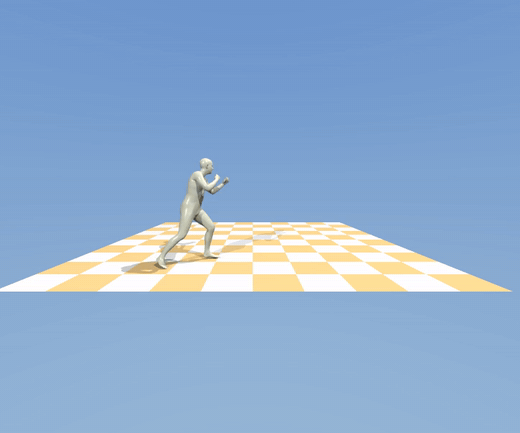
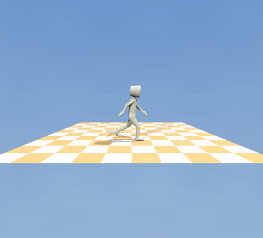
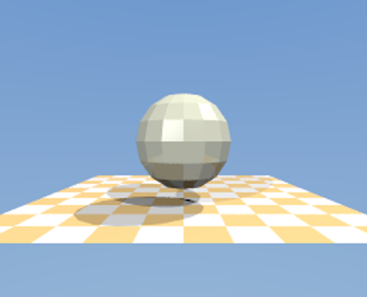

# Render Pipeline

A GPU raytracer that renders human motion in 3D.



Give it a motion clip and it opens a window you can fly around in, or writes a
video file. Above is a flying kick from Motion-X, taken from an online video,
posed with SMPL-X and traced at 20,908 triangles a frame.

Full quality: [kick.mp4](docs/kick.mp4), [walk.mp4](docs/walk.mp4).

## What it does

Every pixel fires a ray into the scene and follows it until it hits something,
then fires more rays at each light to work out the shading. That is thousands of
rays per frame, which is why it runs on the GPU.

It draws triangle meshes, so it can draw anything: a scanned statue, a character
from a game file, or a human body posed by a motion capture model. Geometry can
change every frame, which is what makes animation possible.

## Requirements

* An NVIDIA GPU. The build targets RTX 50 series by default, see below for others.
* CUDA Toolkit 12 or newer
* SDL2
* CMake 3.28+
* Python 3 with numpy, for the motion tools

On Ubuntu or Debian:

```bash
sudo apt install libsdl2-dev cmake build-essential
```

## Build

```bash
cmake -S . -B build -DCMAKE_BUILD_TYPE=Release
cmake --build build
```

Using a different GPU? Change this line in `CMakeLists.txt`, or set it to
`native` to detect your card automatically:

```cmake
set(CMAKE_CUDA_ARCHITECTURES 120)   # 120 = RTX 50 series
```

## Run it

The quickest thing that works, no accounts or downloads:

```bash
curl -sLO https://raw.githubusercontent.com/KhronosGroup/glTF-Sample-Assets/main/Models/CesiumMan/glTF-Binary/CesiumMan.glb
tools/play.sh CesiumMan.glb
```



That opens the viewer with a walking figure. Add `--render out.mp4` to write a
video instead.

The renderer itself takes a mesh sequence and can be driven on its own:

```bash
./build/render-pipeline                    # a generated sphere
./build/render-pipeline model.obj          # your own mesh, scaled to fit
./build/render-pipeline anim.msq           # play an animation
./build/render-pipeline anim.msq frames/   # write frames, then exit
```

### Controls

| Key | Does |
|---|---|
| Drag left mouse | Look around |
| `W` `A` `S` `D` | Move |
| `Q` / `E` | Down / up |
| `Shift` | Move faster |
| `Space` | Pause playback |
| `N` | Smooth or flat shading |
| `P` | Save a screenshot |
| `Esc` | Quit |

## Real human motion

For captured motion you need two things, both free but both behind a signup
form.

| What | Where |
|---|---|
| SMPL-X body model | [smpl-x.is.tue.mpg.de](https://smpl-x.is.tue.mpg.de/) |
| Motion-X clips | [Motion-X](https://github.com/IDEA-Research/Motion-X) |

Motion-X is worth the trouble. It has 81,000 clips and about a third of them
were recovered from ordinary videos found online, which is exactly the kind of
motion this was built to draw.

Take a subset from `motion/motion_generation/smplx322/`, not the one under
`video/`. Those two are named the same and only one holds motion.

```bash
pip install smplx
export SMPLX_MODEL_PATH=~/models        # the folder containing smplx/

# See what is in a subset. There are usually about a thousand clips.
python tools/motion_to_msq.py ~/Downloads/kungfu.zip --list kick

tools/play.sh ~/Downloads/kungfu.zip Kung_Fu_Flying_Kick_1_clip3
tools/play.sh ~/Downloads/kungfu.zip Tai_Chi_Kungfu_7_clip1 --render taichi.mp4
```

Converted clips are cached under `.cache/`, so opening one again is instant.

## How it works

### Smooth shading

A mesh is made of flat pieces. Shade each triangle with its own normal and you
see every one of them.

| Flat | Smooth |
|---|---|
|  |  |

Both have 224 triangles. The second stores a normal at every vertex and blends
the three across each face. The blend weights come free: the ray triangle test
already works out where the hit lands between the corners, and those same
numbers interpolate the normals. Look at the outline of the smooth one and you
can still count the edges.

### Not testing every triangle

The first version tested every triangle for every ray, which scales badly:

| Triangles | Time per frame |
|---|---|
| 224 | 0.7 ms |
| 2,208 | 6.3 ms |
| 25,280 | 54.0 ms |
| 98,601 | 462.6 ms |

That last row is the Stanford Happy Buddha at 2 fps. Triangles now live in a
bounding volume hierarchy, a tree of boxes where a ray that misses a box skips
everything inside it. Same model, same picture, **0.93 ms**. Not one pixel
changed, which is the thing to check when an acceleration structure lands.

Splits are chosen by asking which one makes future rays cheapest. A ray's chance
of entering a box scales with its surface area, so the cost of a split is

```
area(left) x count(left)  +  area(right) x count(right)
```

Minimising that avoids cutting through a dense cluster and leaving half the
model in each child.

### Animation

When the mesh deforms the tree goes stale, but the topology never does, so it
can be refit instead of rebuilt.

| 98,601 triangles | |
|---|---|
| Rebuild | 219.1 ms |
| Refit | 4.06 ms |

A refit tree is cheaper to make and worse to use, roughly 8x slower to traverse
once the mesh has moved far. Which one wins depends on how many samples come out
of it, so the viewer refits and the offline renderer rebuilds. On a 60 frame
clip that choice took the render from 72.8 s to 17.0 s.

### Standing them up

Motion recovered from video inherits the camera's idea of level, and cameras are
rarely level. The kung fu clip arrives 25 degrees off, which makes the figure
lean and appear to float, because as it moves sideways through a tilted world
its height drifts.

`ground_alignment()` measures the tilt instead of assuming it. Up comes from the
plane the feet have been touching, not from posture, since someone mid kick is
not vertical but the floor they stand on never moves. Facing comes from the hip
axis.

| | Before | After |
|---|---|---|
| Floor tilt | 25.3° | 0.2° |
| Frames with a foot on the ground | 8 of 181 | 160 of 181 |

It also knows when not to guess. Footfalls along a single line fit infinitely
many planes, so it checks for spread before trusting the fit, and refuses any
correction beyond 50 degrees.

## The file format

`.msq` is one fixed topology and many frames of vertex positions. Little endian
throughout.

```
magic "MSQ1"      4 bytes
vertex_count      uint32
triangle_count    uint32
frame_count       uint32
fps               float32
indices           triangle_count * 3 * int32
positions         frame_count * vertex_count * 3 * float32
```

Nothing in it mentions skeletons or body models. That is the point. Anything
that can write vertex positions can drive the renderer, and `tools/msq.py`
writes the same format from Python in about twenty lines.

## Files

| | |
|---|---|
| `src/main.cpp` | Window, camera, playback, scene setup |
| `src/render_gpu.cu` | Ray triangle intersection and shading on the GPU |
| `src/bvh.h` | The acceleration structure |
| `src/mesh.h` | Triangle mesh, sphere generator, OBJ loader |
| `src/anim.h` | Mesh sequence reader and writer |
| `src/scene.h` | Materials, lights, camera |
| `src/geom_gpu.cuh` | Vector maths, random numbers, colour |
| `tools/play.sh` | Any motion source to the viewer or a video |
| `tools/motion_to_msq.py` | SMPL and SMPL-X motion to a sequence |
| `tools/gltf_to_msq.py` | Animated glTF character to a sequence |
| `tools/msq.py` | The format, in Python |
| `tools/make_anim.cpp` | Writes a test sequence |

## Speed

On an RTX 5090 at 1280x720, one sample per pixel:

| Scene | Time per frame |
|---|---|
| 98,601 triangle statue | 0.93 ms |
| 20,908 triangle human | under 1 ms |

The picture also improves while you sit still. Samples keep averaging in as long
as nothing changes, so soft shadows and reflections clean themselves up after a
moment. Pausing an animation does the same.

## Credits

Grew out of the [raytracer](../raytracer) in this repo, which came from
[ssloy/tinyraytracer](https://github.com/ssloy/tinyraytracer).

Ray triangle intersection follows Möller and Trumbore (1997). Test character is
[CesiumMan](https://github.com/KhronosGroup/glTF-Sample-Assets) under CC BY.
Motion clips from [Motion-X](https://github.com/IDEA-Research/Motion-X), body
model from [SMPL-X](https://smpl-x.is.tue.mpg.de/).

Both are for non commercial research use and ask to be cited.

```bibtex
@inproceedings{SMPL-X:2019,
  title = {Expressive Body Capture: {3D} Hands, Face, and Body from a Single Image},
  author = {Pavlakos, Georgios and Choutas, Vasileios and Ghorbani, Nima and Bolkart, Timo and Osman, Ahmed A. A. and Tzionas, Dimitrios and Black, Michael J.},
  booktitle = {Proceedings IEEE Conf. on Computer Vision and Pattern Recognition (CVPR)},
  pages     = {10975--10985},
  year = {2019}
}

@article{zhang2025motion,
  title={Motion-X++: A Large-Scale Multimodal 3D Whole-body Human Motion Dataset},
  author={Zhang, Yuhong and Lin, Jing and Zeng, Ailing and Wu, Guanlin and Lu, Shunlin and Fu, Yurong and Cai, Yuanhao and Zhang, Ruimao and Wang, Haoqian and Zhang, Lei},
  journal={arXiv preprint arXiv:2501.05098},
  year={2025}
}

@article{lin2023motionx,
  title={Motion-X: A Large-scale 3D Expressive Whole-body Human Motion Dataset},
  author={Lin, Jing and Zeng, Ailing and Lu, Shunlin and Cai, Yuanhao and Zhang, Ruimao and Wang, Haoqian and Zhang, Lei},
  journal={Advances in Neural Information Processing Systems},
  year={2023}
}
```
