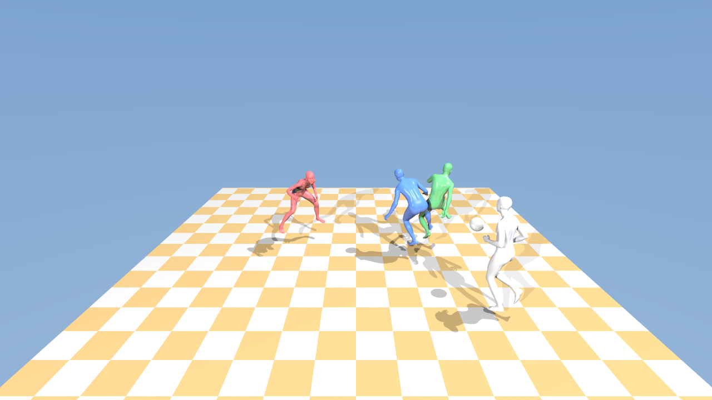

# Render Pipeline

A GPU raytracer that rebuilds human motion from video and draws it in 3D.


Point it at a video and it works out who is in it, what they were doing, and
where the ball went, then opens a window you can fly around in. Above is a
flying kick from Motion-X, traced at 20,908 triangles a frame.

Full quality: [examples.mp4](docs/examples.mp4) shows every example below, the
footage first and then what came out of it.

## What it does

Every pixel fires a ray into the scene and follows it until it hits something,
then fires more rays at each light to work out the shading. That is thousands of
rays per frame, which is why it runs on the GPU.

It draws triangle meshes, so it can draw anything: a scanned statue, a character
from a game file, or four footballers recovered from a broadcast clip. Geometry
can change every frame, which is what makes animation possible.

## Requirements

* An NVIDIA GPU. The build targets RTX 50 series by default, see below for others.
* CUDA Toolkit 12 or newer
* SDL2
* CMake 3.28+
* Python 3 with numpy and scipy, for the motion tools

On Ubuntu or Debian:

```bash
sudo apt install libsdl2-dev cmake build-essential
```

## Build

```bash
cmake -S . -B build -DCMAKE_BUILD_TYPE=Release
cmake --build build
```

Using a different GPU? Change this line in `CMakeLists.txt`, or set it to
`native` to detect your card automatically:

```cmake
set(CMAKE_CUDA_ARCHITECTURES 120)   # 120 = RTX 50 series
```

## Run it

The quickest thing that works, no accounts or downloads:

```bash
curl -sLO https://raw.githubusercontent.com/KhronosGroup/glTF-Sample-Assets/main/Models/CesiumMan/glTF-Binary/CesiumMan.glb
tools/play.sh CesiumMan.glb
```


That opens the viewer with a walking figure. Add `--render out.mp4` to write a
video instead.

The renderer itself can be driven on its own:

```bash
./build/render-pipeline video.mp4              # rebuild a scene from a video
./build/render-pipeline                        # a generated sphere
./build/render-pipeline model.obj              # your own mesh, scaled to fit
./build/render-pipeline anim.msq               # play an animation
./build/render-pipeline anim.msq frames/       # write frames, then exit
./build/render-pipeline anim.msq frames/ 1 24  # one orbit at 24 rays a pixel
```

The last two arguments are optional: how many times to circle the subject while
rendering, and how many rays per pixel to spend. Circling a still model gives it
120 frames, which is the only length it has.

### Controls

| Key | Does |
|---|---|
| Drag left mouse | Look around |
| `W` `A` `S` `D` | Move |
| `Q` / `E` | Down / up |
| `Shift` | Move faster |
| `Space` | Pause playback |
| `N` | Smooth or flat shading |
| `P` | Save a screenshot |
| `Esc` | Quit |

## From a video

Point it at a video and it recovers everyone in it, and the ball, then draws it.

```bash
./build/render-pipeline athlete.mp4
```



One person or several, it is the same command. Four players and a ball out of a
broadcast clip takes four estimator runs and about four minutes. A single figure
takes one.

```bash
python3 tools/video_to_scene.py clip.mp4 --out clip.msq --max-actors 4
```

That is three stages, and each can be run and inspected on its own:

| | |
|---|---|
| `tools/track_people.py` | who is in it and where, on every frame |
| `tools/run_gem.py` | what each of them was doing, one estimator run each |
| `tools/scene_from_video.py` | all of it in one frame, with the ball |

Only the detector and the pose estimator are somebody else's. Tracking,
placement, the ball, and everything that decides whether the result is
physically possible are here.

To see all the examples at once, footage then reconstruction with the camera
circling each result:

```bash
python3 tools/make_examples.py --out docs/examples.mp4
```

### Everybody in one frame

The estimator recovers one person per run, so several people means several runs,
and several runs is where scenes go wrong. Each run returns a world of its own,
and that world only holds together inside the run that produced it. Placing
three of them side by side gives three unrelated coordinate systems. The usual
repair is to fit each actor to the scene, stand them on the floor and centre
them, which puts everybody on the same spot at the same size and throws away the
spacing that was the whole reason to recover more than one person.

What the runs do share is a camera. There was only ever one, so camera space is
the frame all of them are already in, and the scene is assembled there. The
actors are read in camera space, levelled once against the plane their feet have
collectively been touching, then scaled once and placed once.

### Where the ball comes from

The ball is not a body and gets none of that. It is a known 22 cm across, which
is enough on its own. An apparent radius in pixels fixes the distance, and the
pixel it was found at fixes the rest.

The catch is that distance goes as one over the radius. On a ball twenty pixels
wide a single pixel of detector jitter is worth half a metre, while the same
pixel across the frame is worth a centimetre. The trajectory is fitted with
depth weighted accordingly, and the fit runs through the gaps rather than around
them, since the frames where the ball vanishes are the frames where it went
behind somebody and something has to decide what it did there.

Three things then get imposed because they are certain rather than likely. A
ball cannot be under the ground the players stand on. A body cannot cross
several metres in one frame, and the limit for that is a sprinter's top speed,
so what it catches is out by an order of magnitude and is really a tracking box
that slipped. And where the ball sits over a player in the picture, the player's
distance is believed over the ball's own, which is what turns a ball flying past
somebody into a ball at their feet.

On one clip that last rule moved 43 of 45 sightings, by a median of two metres.

There are ready made clips in `samples/`, with their scenes already cached, so
these open straight away:

```bash
./build/render-pipeline samples/soccer_four_players.mp4
./build/render-pipeline samples/kungfu_kick.mp4
./build/render-pipeline samples/soccer_keeper_dive.mp4
```

The result is cached under `.cache/`, so opening the same video again is
instant.

Setting [GEM](https://github.com/NVlabs/GENMO) up is the fiddly part and it is a
separate install. Follow `docs/INSTALL.md` in the clone, then set `GEM_ROOT` if
it is not in `~/GENMO`. Two things in those instructions did not work here:

* The install says PyTorch **cu124**, which ships kernels for sm_50 to sm_90. An
  RTX 50 series card is sm_120 and gets `no kernel image is available for
  execution on the device`. Install `torch==2.7.0` from the **cu128** index.
* The release is missing five files its own code loads from
  `gem/utils/body_model/`. They are in
  [GVHMR](https://github.com/zju3dv/GVHMR) under `hmr4d/utils/body_model/`:
  `coco_aug_dict.pth`, `smpl_coco17_J_regressor.pt`,
  `smpl_neutral_J_regressor.pt`, `smplx2smpl_sparse.pt`, `smplx_verts437.pt`.
  About 1.3 MB in total.

Nothing in GEM is modified. It detects everybody and then keeps only the largest
track, but it caches those boxes and reads them back, so writing that file first
points it at whoever we like.

### How close does it get

Motion-X ships the source videos alongside its motion, so the same clip can go
through both and be compared. On the flying kick:

| | |
|---|---|
| Pose agreement after rigid alignment | 69 mm per joint |
| Distance travelled, GEM | 1.56 m |
| Distance travelled, Motion-X | 1.95 m |

Read that as two independent estimators agreeing to about 7 cm, not as an
accuracy figure. Motion-X's own numbers are estimates from the same footage, not
mocap. The disagreement on travel is the depth ambiguity one camera cannot
resolve.

One thing GEM does noticeably better: its world grounding came out **0.3
degrees** off level, where Motion-X's annotation of the same clip was 25 degrees
off and needed the correction described below.

### Long videos

Broadcast footage cuts between cameras every few seconds and an estimator
reading across a cut sees the person teleport, so clips have to be split where
the footage already breaks rather than on a fixed grid.

Finding those breaks from the picture alone does not work well here. A cut
between two cameras aimed at the same green pitch barely changes the picture, so
the usual scene score stays low, while a fast pan inside one shot sends it high.
On one match a threshold of 0.3 sat above the 99th percentile of every score in
the video and found 13 cuts in three minutes.

So the people are watched instead. `scan_video.py` sweeps a match once, and a
cut is called when the detected bodies jump to an unrelated arrangement or the
grass leaves the frame. The scene score is still used, but only to say which
frame inside the sample the cut landed on.

```bash
python tools/scan_video.py ~/Downloads/archive --out scans/
python tools/clip_video.py --scan scans/ --out-dir clips/ --limit 40
```

On the same match that found 127 cuts, and **65 of them were found only by the
bodies**. Every measurement is kept in the manifest, so cutting and scoring can
be retuned in a fraction of a second rather than by sweeping the footage again.

### Finding the clips worth running

The same sweep classifies each shot, since most footage is unusable no matter
how well it was cut.

| shot | people | height in frame | usable |
|---|---|---|---|
| wide, the tactical camera | 10 to 22 | under 10% | no, too few pixels |
| medium | 2 to 6 | 15% to 40% | yes |
| close | 1 or 2 | over 60% | no, cropped at the waist |
| crowd or graphic | any | any | no, no pitch in view |

A shot is scored on the median player's height as a band rather than a maximum,
on how many comparable bodies are in frame, on whether whole bodies fit inside
it, and on how much of the shot holds more than one person. Framing counts
twice, since a body cropped at the ankles has no ground contact and everything
downstream depends on it.

```bash
python tools/scan_video.py scans/ --report --top 20
```

A 6.7 minute match gives about 10 usable shots.

### What broadcast sport actually gives you

The limit is broadcast direction, not the estimator. A camera framing a whole
pitch cannot give any one player enough pixels, and most of a match is that
camera. The shots that work are the close tracking ones, where a handful of
players fill the frame.

The rest fail in ways worth knowing about:

* Wide play. Twenty two players share the frame and each gets forty pixels.
* Close ups. No legs, so no ground contact and no trajectory.
* VAR split screens. The estimator locks onto a person in an inset panel.
* Slow motion replays. Good pixels, but the muxed frame rate lies about how fast
  the motion really was.
* Shots with no real subject. Given a goal net and a ball it will still produce
  a confident, entirely invented figure.

## Real human motion

For captured motion you need two things, both free but both behind a signup
form.

| What | Where |
|---|---|
| SMPL-X body model | [smpl-x.is.tue.mpg.de](https://smpl-x.is.tue.mpg.de/) |
| Motion-X clips | [Motion-X](https://github.com/IDEA-Research/Motion-X) |

Motion-X is worth the trouble. It has 81,000 clips and about a third of them
were recovered from ordinary videos found online, which is exactly the kind of
motion this was built to draw.

Take a subset from `motion/motion_generation/smplx322/`, not the one under
`video/`. Those two are named the same and only one holds motion.

```bash
pip install smplx
export SMPLX_MODEL_PATH=~/models        # the folder containing smplx/

# See what is in a subset. There are usually about a thousand clips.
python tools/motion_to_msq.py ~/Downloads/kungfu.zip --list kick

tools/play.sh ~/Downloads/kungfu.zip Kung_Fu_Flying_Kick_1_clip3
tools/play.sh ~/Downloads/kungfu.zip Tai_Chi_Kungfu_7_clip1 --render taichi.mp4
```

Converted clips are cached under `.cache/`, so opening one again is instant.

## How it works

### Smooth shading

A mesh is made of flat pieces. Shade each triangle with its own normal and you
see every one of them.

| Flat | Smooth |
|---|---|
|  |  |

Both have 224 triangles. The second stores a normal at every vertex and blends
the three across each face. The blend weights come free: the ray triangle test
already works out where the hit lands between the corners, and those same
numbers interpolate the normals. Look at the outline of the smooth one and you
can still count the edges.

### Not testing every triangle

The first version tested every triangle for every ray, which scales badly:

| Triangles | Time per frame |
|---|---|
| 224 | 0.7 ms |
| 2,208 | 6.3 ms |
| 25,280 | 54.0 ms |
| 98,601 | 462.6 ms |

That last row is the Stanford Happy Buddha at 2 fps. Triangles now live in a
bounding volume hierarchy, a tree of boxes where a ray that misses a box skips
everything inside it. Same model, same picture, **0.93 ms**. Not one pixel
changed, which is the thing to check when an acceleration structure lands.

Splits are chosen by asking which one makes future rays cheapest. A ray's chance
of entering a box scales with its surface area, so the cost of a split is

```
area(left) x count(left)  +  area(right) x count(right)
```

Minimising that avoids cutting through a dense cluster and leaving half the
model in each child.

### Animation

When the mesh deforms the tree goes stale, but the topology never does, so it
can be refit instead of rebuilt.

| 98,601 triangles | |
|---|---|
| Rebuild | 219.1 ms |
| Refit | 4.06 ms |

A refit tree is cheaper to make and worse to use, roughly 8x slower to traverse
once the mesh has moved far. Which one wins depends on how many samples come out
of it, so the viewer refits and the offline renderer rebuilds. On a 60 frame
clip that choice took the render from 72.8 s to 17.0 s.

A scene of four players and a ball is 84,592 triangles in one tree, which
traverses exactly as one body does. Nothing about the renderer knows there is
more than one thing in it.

### Standing them up

Motion recovered from video inherits the camera's idea of level, and cameras are
rarely level. The kung fu clip arrives 25 degrees off, which makes the figure
lean and appear to float, because as it moves sideways through a tilted world
its height drifts.

`ground_alignment()` measures the tilt instead of assuming it. Up comes from the
plane the feet have been touching, not from posture, since someone mid kick is
not vertical but the floor they stand on never moves. Facing comes from the hip
axis.

| | Before | After |
|---|---|---|
| Floor tilt | 25.3° | 0.2° |
| Frames with a foot on the ground | 8 of 181 | 160 of 181 |

It also knows when not to guess. Footfalls along a single line fit infinitely
many planes, so it checks for spread before trusting the fit, and refuses any
correction beyond 50 degrees.

A scene does the same thing with every actor's feet pooled together, which is a
better measurement than any one of them alone. It levels but never turns the
scene, since turning a subject to face the camera means nothing once there are
several of them facing different ways.

## The file format

`.msq` is one fixed topology and many frames of vertex positions. Little endian
throughout.

```
magic "MSQ1"      4 bytes
vertex_count      uint32
triangle_count    uint32
frame_count       uint32
fps               float32
indices           triangle_count * 3 * int32
positions         frame_count * vertex_count * 3 * float32
```

Nothing in it mentions skeletons or body models. That is the point. Anything
that can write vertex positions can drive the renderer, and `tools/msq.py`
writes the same format from Python in about twenty lines.

A scene holds more than one thing, and `MSQ2` adds a table saying which run of
triangles is whose. Everybody still shares one vertex array and one triangle
list, so the renderer keeps one mesh and one tree. Only the colour lookup at a
hit changes.

```
magic "MSQ2"      4 bytes
vertex_count      uint32
triangle_count    uint32
frame_count       uint32
fps               float32
object_count      uint32
objects           object_count * (first_triangle uint32, triangle_count uint32,
                                  colour 3 * float32)
indices           triangle_count * 3 * int32
positions         frame_count * vertex_count * 3 * float32
```

An object names a colour and nothing else about how to shade it. Which shirt a
player wears comes out of the video and only the tools upstream can know it. How
cloth answers a light belongs to the renderer and is the same for everyone.
`MSQ1` still loads, as one object.

## Files

| | |
|---|---|
| `src/main.cpp` | Window, camera, playback, scene setup |
| `src/render_gpu.cu` | Ray triangle intersection and shading on the GPU |
| `src/bvh.h` | The acceleration structure |
| `src/mesh.h` | Triangle mesh, sphere generator, OBJ loader |
| `src/anim.h` | Mesh sequence reader and writer |
| `src/scene.h` | Materials, lights, camera |
| `src/geom_gpu.cuh` | Vector maths, random numbers, colour |
| `tools/play.sh` | Any motion source to the viewer or a video |
| `tools/video_to_scene.py` | Video to a scene, running the three stages below |
| `tools/track_people.py` | Everyone in a clip, followed frame by frame |
| `tools/run_gem.py` | One estimator run per tracked person |
| `tools/scene_from_video.py` | Actors and ball into one frame, as a sequence |
| `tools/scene_msq.py` | Merges sequences and a ball into one scene |
| `tools/scan_video.py` | Sweeps a match for its cuts and what is in each shot |
| `tools/clip_video.py` | Cuts a match into clips worth estimating from |
| `tools/rank_clips.py` | Scores clips that are already cut |
| `tools/make_examples.py` | Builds the examples video |
| `tools/video_to_msq.py` | One person from a video, via GEM |
| `tools/motion_to_msq.py` | SMPL and SMPL-X motion to a sequence |
| `tools/gltf_to_msq.py` | Animated glTF character to a sequence |
| `tools/msq.py` | The format, in Python |
| `tools/make_anim.cpp` | Writes a test sequence |

## Speed

On an RTX 5090 at 1280x720, one sample per pixel:

| Scene | Time per frame |
|---|---|
| 98,601 triangle statue | 0.93 ms |
| 20,908 triangle human | under 1 ms |
| 84,592 triangle scene, four players and a ball | under 1 ms |

Rebuilding a scene from a video is dominated by the estimator, which runs once
per person and takes about a minute each. Tracking a clip takes seconds, and
everything after the estimator takes under one.

The picture also improves while you sit still. Samples keep averaging in as long
as nothing changes, so soft shadows and reflections clean themselves up after a
moment. Pausing an animation does the same.

## Credits

Grew out of the [raytracer](../raytracer) in this repo, which came from
[ssloy/tinyraytracer](https://github.com/ssloy/tinyraytracer).

Ray triangle intersection follows Möller and Trumbore (1997). Test character is
[CesiumMan](https://github.com/KhronosGroup/glTF-Sample-Assets) under CC BY.
Motion clips from [Motion-X](https://github.com/IDEA-Research/Motion-X), body
model from [SMPL-X](https://smpl-x.is.tue.mpg.de/), motion estimation from
[GEM](https://github.com/NVlabs/GENMO).

All three are for non commercial research use and ask to be cited.

```bibtex
@inproceedings{SMPL-X:2019,
  title = {Expressive Body Capture: {3D} Hands, Face, and Body from a Single Image},
  author = {Pavlakos, Georgios and Choutas, Vasileios and Ghorbani, Nima and Bolkart, Timo and Osman, Ahmed A. A. and Tzionas, Dimitrios and Black, Michael J.},
  booktitle = {Proceedings IEEE Conf. on Computer Vision and Pattern Recognition (CVPR)},
  pages     = {10975--10985},
  year = {2019}
}

@article{zhang2025motion,
  title={Motion-X++: A Large-Scale Multimodal 3D Whole-body Human Motion Dataset},
  author={Zhang, Yuhong and Lin, Jing and Zeng, Ailing and Wu, Guanlin and Lu, Shunlin and Fu, Yurong and Cai, Yuanhao and Zhang, Ruimao and Wang, Haoqian and Zhang, Lei},
  journal={arXiv preprint arXiv:2501.05098},
  year={2025}
}

@article{lin2023motionx,
  title={Motion-X: A Large-scale 3D Expressive Whole-body Human Motion Dataset},
  author={Lin, Jing and Zeng, Ailing and Lu, Shunlin and Cai, Yuanhao and Zhang, Ruimao and Wang, Haoqian and Zhang, Lei},
  journal={Advances in Neural Information Processing Systems},
  year={2023}
}
```
